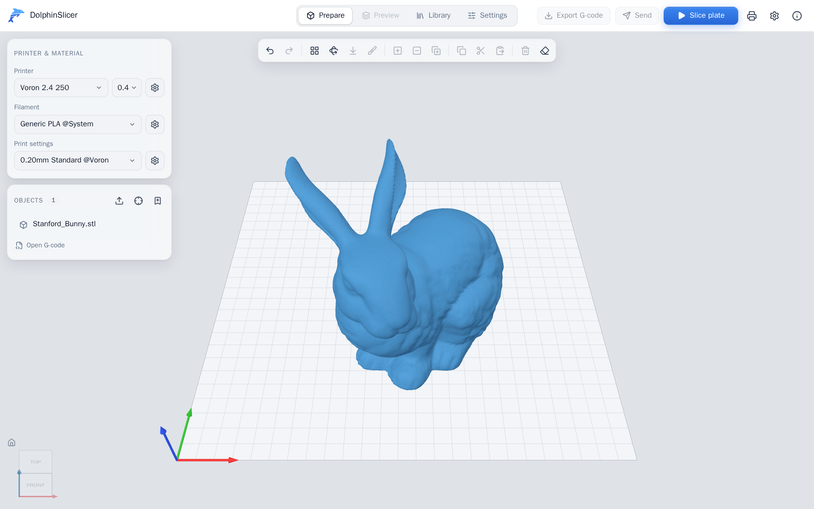
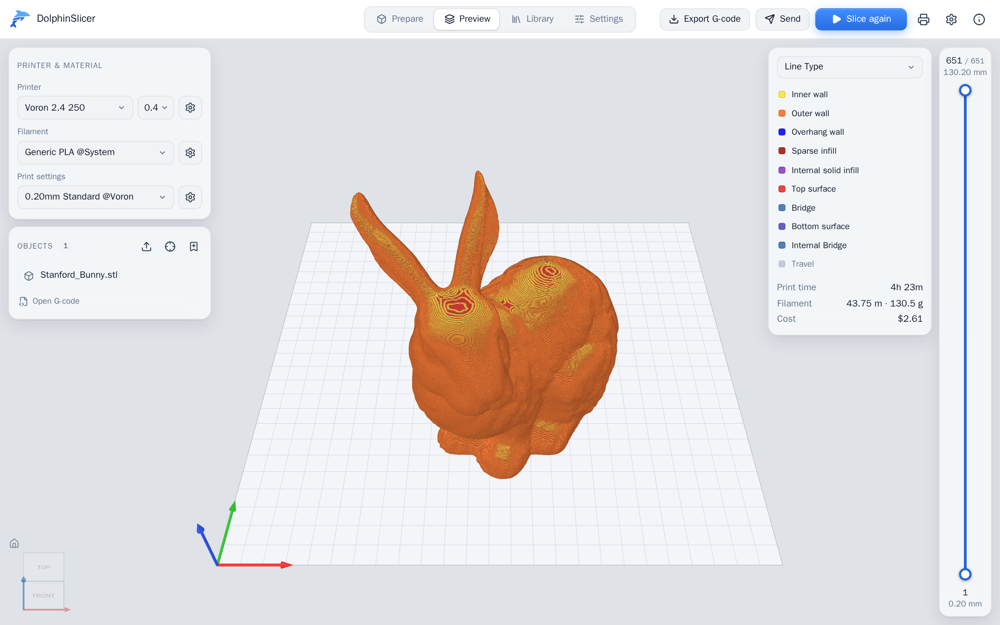
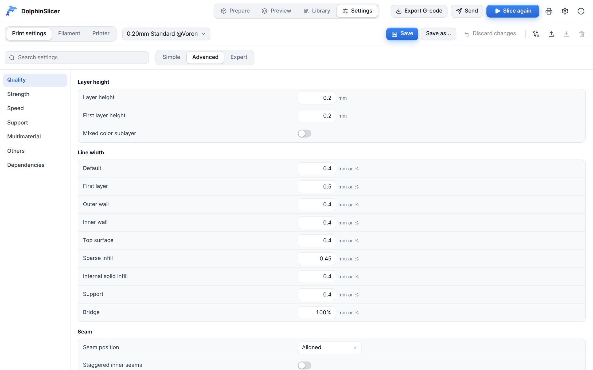

  

<h1 align="center">DolphinSlicer</h1>

  <strong>OrcaSlicer in your browser.</strong> 
  Slice 3D models right in the browser, with nothing to install and nothing uploaded.

  <a href="https://dolphinslicer.app"><strong>Open DolphinSlicer&nbsp;→</strong></a>

  
  
  

  <picture>
    <source media="(prefers-color-scheme: dark)" srcset="docs/images/prepare-dark.png">
    
  </picture>

## Why DolphinSlicer?

DolphinSlicer runs the real [OrcaSlicer](https://github.com/OrcaSlicer/OrcaSlicer) slicing engine,
compiled to WebAssembly. You get the same G-code as the desktop app, on any computer with a modern
browser.

- **Nothing to install.** Open [dolphinslicer.app](https://dolphinslicer.app) and start slicing.
- **Private.** Your models are sliced on your own computer and never leave it.
- **The same results as the desktop app.** Same engine, same settings, same printer profiles.
- **Free and open source**, under the GNU AGPL v3.0.

## Features

  <picture>
    <source media="(prefers-color-scheme: dark)" srcset="docs/images/preview-dark.png">
    
  </picture>

- **Import** STL, 3MF, OBJ and AMF files. 3MF projects keep their positions and per-object settings.
- **Prepare your plate**: move, rotate and scale, arrange, auto orient, lay on face and paint supports.
- **Preview the G-code** layer by layer, colored by line type, speed and more, with print time,
  filament use and cost.
- **Printer profiles** for 70+ brands, the same ones OrcaSlicer ships, plus your own custom printers
  and nozzle variants.
- **Calibration tests** from OrcaSlicer: temperature tower, flow rate, pressure advance, retraction,
  max flowrate, VFA, input shaping and cornering.
- **Send to your printer** over Klipper (Moonraker) or OctoPrint, or export the G-code.
- **Model library** to keep the models you print often.
- **Google Drive sync** (optional) for your presets, models and settings, across all your devices.
- **Works with your OrcaSlicer presets**: import and export printer, filament and process presets,
  and bring presets over from PrusaSlicer.
- **"Slice now" links** that open a model from your website straight in DolphinSlicer
  ([how to add one](docs/QUICK_LINK.md)).
- **In your language**: the interface uses OrcaSlicer's translations in 22 languages.

  <picture>
    <source media="(prefers-color-scheme: dark)" srcset="docs/images/settings-dark.png">
    
  </picture>

## Getting started

1. Open **[dolphinslicer.app](https://dolphinslicer.app)**. The first time, pick your printers and
   filaments.
2. Drop your models onto the plate.
3. Click **Slice plate**, check the preview, then **Export G-code** or **Send** it to your printer.

Use a recent desktop browser such as Chrome, Edge or Firefox. Slicing uses all your CPU cores when
the browser allows it.

## Run it on your printer

You can also host DolphinSlicer yourself, for example on the Raspberry Pi that runs your printer
next to Mainsail or Fluidd. See [Running DolphinSlicer on your printer](docs/SELF_HOST_PI.md).

## Privacy

DolphinSlicer has no accounts, no ads and no tracking. Read the
[privacy policy](https://dolphinslicer.app/privacy).

## Development

DolphinSlicer has two parts:

- **[`engine/`](engine/README.md)**: OrcaSlicer 2.5.0's slicing core built with Emscripten, in a
  single-threaded and a multithreaded version. Tests check its G-code against desktop OrcaSlicer's.
- **[`app/`](app/README.md)**: the web app (Vite, React and three.js), a static site.

Each folder's README explains how to build and test it. Changes go through pull requests with
[Conventional Commits](https://www.conventionalcommits.org) titles; each pull request gets its own
preview deployment.

## Credits and license

DolphinSlicer is built on [OrcaSlicer](https://github.com/OrcaSlicer/OrcaSlicer) by SoftFever and
contributors, itself based on Bambu Studio, PrusaSlicer and Slic3r. Build recipes and several fixes
come from [OrcaWeb](https://github.com/Hiosdra/OrcaWeb). See [NOTICE](NOTICE) for all credits.

The model in the screenshots is the Stanford Bunny by the Stanford Computer Graphics Laboratory, one
of OrcaSlicer's sample models.

DolphinSlicer is free software under the
[GNU Affero General Public License v3.0 or later](LICENSE).
