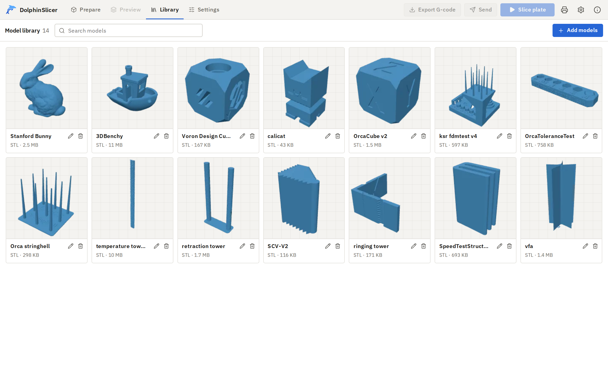
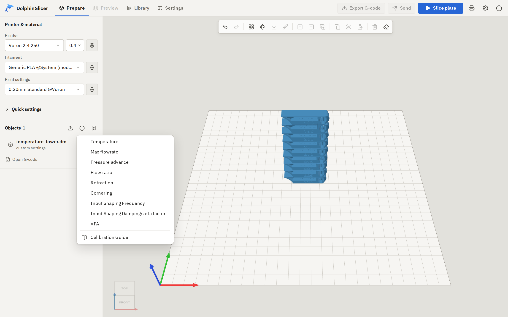

  

<h1 align="center">DolphinSlicer</h1>

<h3 align="center">OrcaSlicer in your browser.</h3>

  Slice 3D models right in the browser, with nothing to install and nothing uploaded.

  <a href="https://dolphinslicer.app"><strong>Open DolphinSlicer&nbsp;→</strong></a>

  
  
  

 

  <picture>
    <source media="(prefers-color-scheme: dark)" srcset="docs/images/prepare-dark.png">
    
  </picture>

 

## Why DolphinSlicer?

DolphinSlicer runs the real [OrcaSlicer](https://github.com/OrcaSlicer/OrcaSlicer) slicing engine,
compiled to WebAssembly. You get the same G-code as the desktop app, on any computer with a modern
browser.

- **Nothing to install.** Open [dolphinslicer.app](https://dolphinslicer.app) and start slicing.
- **Private.** Your models never leave your computer. No accounts, no ads, no tracking
  ([privacy policy](https://dolphinslicer.app/privacy)).
- **Same results as the desktop app.** Same engine, settings and printer profiles.
- **Free and open source** under the GNU AGPL v3.0.

## Features

- **Prepare your plate**: import STL, 3MF, OBJ and AMF, then arrange, rotate, scale and paint supports.
- **Preview the G-code** layer by layer, with print time, filament use and cost, and play a layer back in real time with the nozzle shown.
- **Printer profiles** for 70+ brands, plus your own printers and OrcaSlicer presets.
- **Calibration tests**: temperature, flow, pressure advance, retraction and more.
- **Send to your printer** over Klipper or OctoPrint, or export the G-code.
- **Model library** with optional **Google Drive sync** across your devices.
- **"Slice now" links** that open a model from your website ([how to add one](docs/QUICK_LINK.md)).
- **AI assistants** like Claude and ChatGPT can explain and change your settings ([how to connect](docs/MCP.md)).

 

  <picture>
    <source media="(prefers-color-scheme: dark)" srcset="docs/images/preview-dark.png">
    
  </picture>
  <picture>
    <source media="(prefers-color-scheme: dark)" srcset="docs/images/settings-dark.png">
    
  </picture>

  <picture>
    <source media="(prefers-color-scheme: dark)" srcset="docs/images/library-dark.png">
    
  </picture>
  <picture>
    <source media="(prefers-color-scheme: dark)" srcset="docs/images/calibration-dark.png">
    
  </picture>

 

## Getting started

1. Open **[dolphinslicer.app](https://dolphinslicer.app)**. The first time, pick your printers and
   filaments.
2. Drop your models onto the plate.
3. Click **Slice plate**, check the preview, then **Export G-code** or **Send** it to your printer.

Use a recent desktop browser such as Chrome, Edge or Firefox.

You can also host DolphinSlicer yourself, with your presets and models stored there instead of in
Google Drive: on the Raspberry Pi that runs your printer ([how to](docs/SELF_HOST_PI.md)), or on a
home server with Docker ([how to](docs/SELF_HOST_DOCKER.md)).

## Development

DolphinSlicer has two parts:

- **[`engine/`](engine/README.md)**: OrcaSlicer 2.5.0's slicing core built with Emscripten, in a
  single-threaded and a multithreaded version. Tests check its G-code against desktop OrcaSlicer's.
- **[`app/`](app/README.md)**: the web app (Vite, React and three.js), a static site.

Each folder's README explains how to build and test it. Changes go through pull requests with
[Conventional Commits](https://www.conventionalcommits.org) titles; each pull request gets its own
preview deployment.

## Credits and license

DolphinSlicer is built on [OrcaSlicer](https://github.com/OrcaSlicer/OrcaSlicer) by SoftFever and
contributors, itself based on Bambu Studio, PrusaSlicer and Slic3r. Build recipes and several fixes
come from [OrcaWasm](https://github.com/Hiosdra/OrcaWasm). See [NOTICE](NOTICE) for all credits.

The models in the screenshots are OrcaSlicer's sample and calibration models, among them the
Stanford Bunny by the Stanford Computer Graphics Laboratory and 3DBenchy by Creative Tools.

DolphinSlicer is free software under the
[GNU Affero General Public License v3.0 or later](LICENSE).
